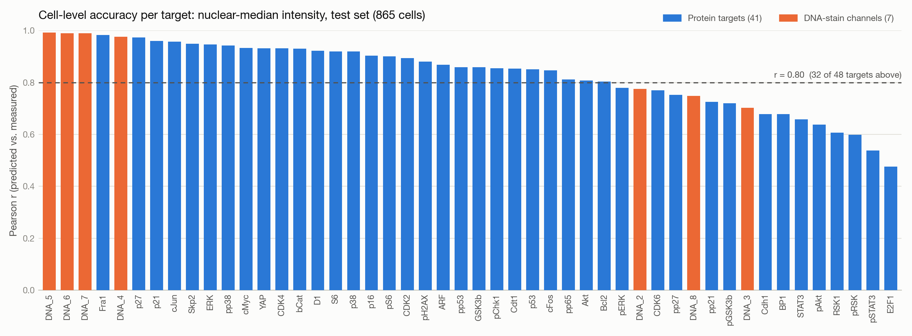
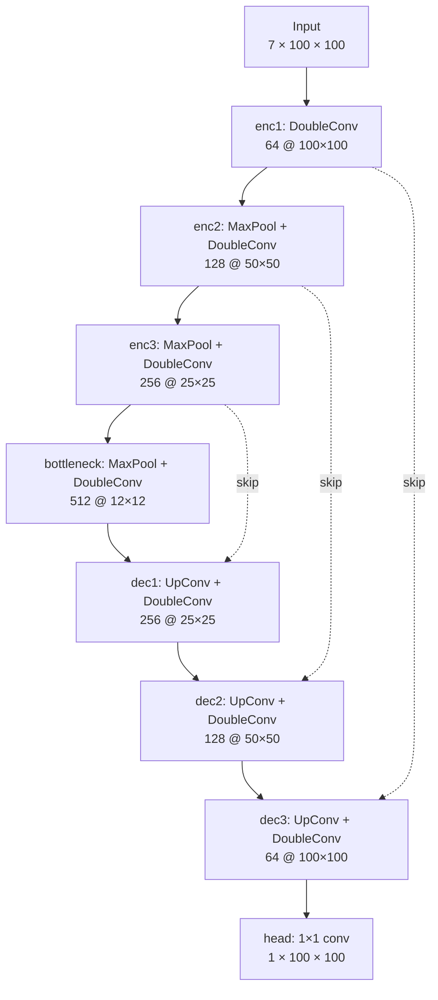

# StainNet

[](https://www.python.org/)
[](https://pytorch.org/)

Predicting unmeasured protein stains from a small panel of cell-cycle markers in multiplexed single-cell fluorescence images.

## Key results

- **48 targets** (41 proteins, 7 DNA-stain channels) predicted from 7 input channels, one TinyUNet per target, evaluated on **865 held-out cells**.
- **Cell-level accuracy:** Pearson r of per-cell nuclear-median intensity (predicted vs. measured) has a mean of **0.833** and a median of **0.859**; **32 of 48** targets exceed r = 0.80.
- **Pixel metrics understate cell-level accuracy** for many targets: ERK has a median SSIM of 0.55 but r = 0.95.



The DNA-stain channels are coloured separately because `DNA_1` is one of the inputs. The figure contains only per-target aggregates and can be regenerated with [`src/utilities/plot_target_ranking.py`](src/utilities/plot_target_ranking.py).

## Contents

[Overview](#overview) · [Method](#method) · [Evaluation](#evaluation) · [Results](#results) · [Repository structure](#repository-structure) · [How to run](#how-to-run) · [Data](#data) · [Acknowledgments](#acknowledgments) · [Usage](#usage)

## Overview

Multiplexed immunofluorescence can measure dozens of proteins per cell, but every extra antibody stain adds time, reagents, and imaging rounds. StainNet asks how much of that panel can be **predicted instead of measured**: given 7 input channels (cell-cycle markers plus a DNA stain) of a 59-channel single-cell image, a small U-Net predicts the spatial expression of one unmeasured protein. One model is trained per target, for 48 targets.

If a target can be predicted well from the inputs, it may not need its own stain in future experiments.

## Method

### Data and input/output format

Each sample is a 59 × 100 × 100 single-cell crop (`uint16`, channel-first TIFF) from Stallaert et al. (2022); see [Data](#data). The channel order is defined in [`src/utilities/mapping.py`](src/utilities/mapping.py):

| Role | Channels |
|---|---|
| **Inputs (7)** | `PCNA-mTq2`, `Rb`, `cycA`, `cycB1`, `cycE`, `pRb`, `DNA_1` |
| **Targets (48)** | every other imaging channel, including the DNA-stain channels `DNA_2`–`DNA_8` |
| **Masks (4, not predicted)** | `nuc`, `cell`, `cyto`, `ring` segmentation masks, used only for evaluation |

- **Input:** `7 × 100 × 100` float tensor.
- **Output:** `1 × 100 × 100` predicted target channel.
- **Normalization:** per-channel mean/std computed on the **training split only** ([`compute_dataset_stats.py`](src/utilities/compute_dataset_stats.py)) and reused unchanged for validation and test. Inputs and target are z-scored, and predictions are de-normalized back to raw intensity for the cell-level metrics.

### Architecture: TinyUNet

[`src/models.py`](src/models.py) defines a compact U-Net with three downsampling stages, a bottleneck, three upsampling stages, and concatenation skip connections. Each block is a `DoubleConv` (two `3×3 conv → BatchNorm → ReLU` layers). Downsampling uses `2×2` max-pooling; upsampling uses a `2×2` transposed convolution, bilinearly resized to the skip tensor when sizes differ (25 → 12 → 24 → 25). With `base_channels = 64` the model has **7,702,465 trainable parameters (≈ 7.7 M)**.



### Training

One independent model per target ([`src/train.py`](src/train.py)), with the settings used for the 48-target sweep:

| Setting | Value |
|---|---|
| Loss | L1 on the normalized target |
| Optimizer | Adam, learning rate 1e-3 |
| Schedule | `ReduceLROnPlateau` on validation L1: halve the learning rate after 5 epochs without improvement |
| Epochs / batch size | up to 50 / 16 |
| Checkpoint | best validation L1 (`best.pt`); `last.pt` is also kept |
| Model | TinyUNet, `base_channels = 64` |
| Seed | 42 |
| Augmentation | none (a `--augment` flip/rotate option exists but was not used in this sweep) |

## Evaluation

### Train/val/test split

[`src/split.py`](src/split.py) shuffles the list of image files with a fixed seed (42) and splits it **70 / 20 / 10** into **6,054 / 1,730 / 865** images. The split is at the **image level**, and each image is one single-cell crop. There is no stratification, and cells are assigned independently (no grouping by source field of view). Every target is evaluated on the same 865 test cells.

### Metrics

[`src/evaluate.py`](src/evaluate.py) writes per-image metrics (`metrics.csv`) and split-level aggregates (`summary.json`).

- **Pixel level** (normalized space, per test image): L1, MSE, and SSIM (7×7 window, data range taken from each target image).
- **Cell level** (raw intensity): for each crop, the centre cell is identified from the nuclear mask (the label at the centre pixel, otherwise the nearest centroid). Mean and median predicted and measured intensities are computed inside that cell's **nuclear** and **cytoplasmic** masks. Pearson and Spearman correlations between predicted and measured values are then computed **across the test cells** (`nuc_mean`, `nuc_median`, `cyto_mean`, `cyto_median`).

The **primary metric** is the Pearson r of per-cell **nuclear-median** intensity, predicted vs. measured, across the 865 test cells. It asks whether the model ranks cells correctly by expression, which is what downstream single-cell analysis depends on.

## Results

48 targets, one model each, all evaluated on the same 865 test cells (ranked per target in the figure under [Key results](#key-results)):

| Metric | Value |
|---|---|
| Mean Pearson r (nuclear median) | **0.833** |
| Median Pearson r (nuclear median) | **0.859** |
| Targets with r > 0.80 | **32 of 48** |
| Mean per-target SSIM | 0.681 (range 0.287–0.923) |

- **Best protein targets:** Fra1 (0.983), p27 (0.973), p21 (0.961), cJun (0.958).
- **Weakest:** E2F1 (0.476), and a group of signalling readouts (pAkt, pRSK, pSTAT3, RSK1) at 0.538–0.637.
- **Pixel-level and cell-level metrics often disagree.** ERK, for example, has a median SSIM of 0.55 but r = 0.95: the predicted image is not a faithful pixel-by-pixel reconstruction, yet it ranks cells by ERK level very well. For single-cell analysis, the cell-level ranking is the more meaningful indicator.

## Repository structure

```
StainNet/
├── src/
│   ├── models.py                  # TinyUNet
│   ├── dataset.py                 # 59-channel TIFF dataset, manifest + stats loading
│   ├── augmentation.py            # joint flip/rotate (optional)
│   ├── split.py                   # 70/20/10 split manifest
│   ├── train.py                   # training loop (one target per run)
│   ├── evaluate.py                # pixel + cell-level evaluation on val/test
│   ├── infer.py                   # predictions for arbitrary TIFFs
│   ├── train_smoke_test.py        # tiny end-to-end sanity run
│   └── utilities/
│       ├── mapping.py             # channel names, input/target selection
│       ├── compute_dataset_stats.py
│       ├── inspect_data.py
│       └── plot_target_ranking.py # results figure
├── slurm/                         # SLURM jobs (*.sbatch) and submit scripts
├── notebooks/                     # data validation, napari eval viewer, results analysis
├── docs/figures/                  # README figure
├── download_eval_results.sh       # fetch summary.json/metrics.csv from a cluster
└── requirements.txt
```

## How to run

### 1. Environment

Create a Python 3.11 environment (for example with [Miniforge](https://github.com/conda-forge/miniforge), or `python -m venv`) and install the dependencies with pip:

```bash
conda create -n stainnet -c conda-forge python=3.11
conda activate stainnet
pip install -r requirements.txt
```

On Linux, the PyPI `torch` wheels include CUDA support; for a specific CUDA version, follow the [PyTorch install guide](https://pytorch.org/get-started/locally/). The napari eval viewer notebook additionally needs `pip install "napari[all]"`.

### 2. Data layout

Place (or symlink) the dataset at `data/` in the repository root. Split manifests store repo-relative paths such as `data/stacked_raw/cell_0001.tif`.

```
data/
├── stacked_raw/   # one 59 × 100 × 100 TIFF per cell
├── splits/        # stacked_raw_split.json   (step 3)
└── stats/         # stacked_raw_stats_*.json (step 3)
```

```bash
ln -s /path/to/dataset data
```

### 3. Split and normalization statistics

```bash
python src/split.py                               # -> data/splits/stacked_raw_split.json
python src/utilities/compute_dataset_stats.py     # -> data/stats/stacked_raw_stats_{train,all}.json
```

### 4. Train and evaluate one target

```bash
python src/train.py --target Akt --base-channels 64 --epochs 50 --lr-patience 5 \
    --run-name Akt_bc64 --no-wandb
python src/evaluate.py --checkpoint runs/Akt_bc64/checkpoints/best.pt --split test
```

Every script takes `--help`. Data paths can be overridden with `--manifest`, `--stats`, and `--output-dir`. Weights & Biases logging is on by default; disable it with `--no-wandb`. To predict on new crops:

```bash
python src/infer.py --checkpoint runs/Akt_bc64/checkpoints/best.pt --input path/to/crops/
```

### 5. Full sweep on a SLURM cluster

The scripts in `slurm/` keep the resource requests (per target: 1 GPU, 4 CPUs, 16 GB memory, 1–1.5 h time limit). Cluster-specific values come from environment variables:

| Variable | Meaning | Default |
|---|---|---|
| `PROJECT_DIR` | project checkout on the cluster | the submit directory |
| `PARTITION` | partition passed by the `submit_*.sh` scripts | cluster default |
| `SCRATCH_ROOT` | node-local scratch for staging `data/` | `$TMPDIR` or `/tmp` |
| `DATA_DIR`, `RUNS_DIR` | data and run directories | `$PROJECT_DIR/data`, `$PROJECT_DIR/runs` |
| `CONDA_MODULE`, `CONDA_ENV` | conda module to load, env to activate | `anaconda`, `stainnet` |

```bash
mkdir -p logs
python src/split.py                                             # split manifest (once)
sbatch -p <cpu_partition> slurm/stats.sbatch                    # normalization stats
PARTITION=<gpu_partition> SCRATCH_ROOT=<node_local_scratch> \
    bash slurm/submit_all_targets.sh                            # train + test-eval all 48 targets
```

Each job trains one target and evaluates it on the test split into `runs/all_targets/<target>_<jobid>/eval/test/`. To copy only the result summaries back to a local machine:

```bash
CLUSTER=<user>@<cluster> bash download_eval_results.sh all_targets   # -> local_runs/all_targets/
python src/utilities/plot_target_ranking.py --runs-dir local_runs/all_targets
```

### Notebook hygiene

Notebook outputs are stripped on commit by an [nbstripout](https://github.com/kynan/nbstripout) git filter (see `.gitattributes`). Enable it once per clone:

```bash
pip install nbstripout
nbstripout --install
git config filter.nbstripout.clean "$(git config filter.nbstripout.clean) --keep-id"
```

## Data

This project uses a multiplexed iterative immunofluorescence dataset of hTERT-RPE-1 cells (59 channels, 8,649 single-cell images) from Stallaert et al. (2022), *Cell Systems*. Raw images are not included in this repository.

> Stallaert W, Kedziora KM, Taylor CD, Zikry TM, Ranek JS, Sobon HK, Taylor SR, Young CL, Cook JG, Purvis JE. **The structure of the human cell cycle.** *Cell Systems* 13(3):230–240.e3 (2022). [https://doi.org/10.1016/j.cels.2021.10.007](https://doi.org/10.1016/j.cels.2021.10.007)

## Acknowledgments

This work was carried out in the Xing Lab, University of Pittsburgh. Thanks to Gaohan Yu for supervision and guidance.

## Usage

This repository is shared for demonstration and portfolio purposes. No license is granted: the code may not be copied, modified, or redistributed without permission. Please get in touch if you would like to use any part of it. The underlying dataset is described in Stallaert et al. (2022) and is not covered by this repository.
